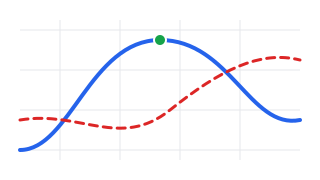

<!--
Copyright (c) 2026 Apurva Nakade. All rights reserved.
Released under Apache 2.0 license as described in the file LICENSE.
Authors: Apurva Nakade
-->

<!--
Shows: every vm-swatch modifier beside the trace it names, and the prose
the mathviz theme styles (headings, callouts, a theorem and proof, a table,
a blockquote, a figure on its dark-mode backing, code, inline and display
math), and embedding one app (?embed=palette).

  vm-swatch: https://apurvanakade.github.io/mathviz/docs/markup.html#vm-swatch
  theme:     https://apurvanakade.github.io/mathviz/docs/site.html#theme
  embedding: https://apurvanakade.github.io/mathviz/docs/site.html#embedding
-->

```{ojs}
VM = window.VM
vmTheme = Generators.observe(notify => VM.plotting.onThemeChange(notify))
chartColors = VM.plotting.colors(vmTheme)
```

## Color words

A word in a sentence can carry the color of the trace it names. In the chart, <span class="vm-swatch vm-swatch-fn">fn</span>, <span class="vm-swatch vm-swatch-alt">alt</span>, <span class="vm-swatch vm-swatch-ok">ok</span>, <span class="vm-swatch vm-swatch-muted">muted</span>, <span class="vm-swatch vm-swatch-ink">ink</span>, <span class="vm-swatch vm-swatch-warn">warn</span>, <span class="vm-swatch vm-swatch-accent2">accent2</span> and <span class="vm-swatch vm-swatch-accent3">accent3</span> are the eight palette colors, top to bottom; <span class="vm-swatch vm-swatch-accent">accent</span> is the color of links and buttons. Toggle the theme: the words and the lines change together.

::: {.vm-app #palette}
::: {.ojs-chart-block}
```{ojs}
{
  const names = ["fn", "alt", "ok", "muted", "ink", "warn", "accent2", "accent3"]
  const xs = []
  for (let i = 0; i <= 100; i++) xs.push(i / 100)
  const data = names.map((name, k) => ({
    name, x: xs, y: xs.map(x => names.length - k + 0.3 * Math.sin(2 * Math.PI * (x + k / 8))),
    line: {color: chartColors[name], width: 3}
  }))
  const div = document.createElement("div")
  div.style.height = "360px"
  Plotly.newPlot(div, data, VM.plotting.layout({showlegend: false, yaxis: {showticklabels: false}}), VM.plotting.config())
  VM.plotting.autoResize(div)
  return div
}
```
:::
:::

## The theme's prose

With the mathviz theme, Bootstrap's own elements take the panels' colors too. This is a paragraph with a [link](index.qmd), some `inline code`, and inline math, $\int_0^1 x^2\,dx = \tfrac13$, which sits at the paragraph's line height.

### Callouts

::: {.callout-note}
A note: one gap above and below every callout, theorem, table and figure.
:::

::: {.callout-tip}
## A tip with a title
Copy any page in this folder to start a new one.
:::

::: {.callout-warning}
A warning, for the step a reader is likely to get wrong.
:::

### A theorem

::: {#thm-mvt}
## Mean value theorem
If $f$ is continuous on $[a, b]$ and differentiable on $(a, b)$, there is a $c \in (a, b)$ with
$$
f'(c) = \frac{f(b) - f(a)}{b - a}.
$$
:::

::: {.proof}
Apply Rolle's theorem to $g(x) = f(x) - \frac{f(b) - f(a)}{b - a}(x - a)$.
:::

@thm-mvt is what makes Newton's method's error estimate work.

### A table

| method | order | evaluations per step |
|---|---|---|
| Euler | 1 | 1 |
| midpoint | 2 | 2 |
| RK4 | 4 | 4 |

: One-step methods for $y' = f(t, y)$.

### A quotation

> The purpose of computing is insight, not numbers.
>
> --- Richard Hamming

### A figure

{width=240}

### Code

```python
def newton(f, df, x, steps=10):
    for _ in range(steps):
        x = x - f(x) / df(x)
    return x
```

## Embedding

Press Share above the palette chart, or add `?embed=palette` to this page's address: the app shows alone, ready for another site's `<iframe>`. The note at the very bottom of every page (`banner.html`) is the site's own chrome, outside the page content; its `data-vm-embed-hide` attribute is what keeps it out of the frame.
